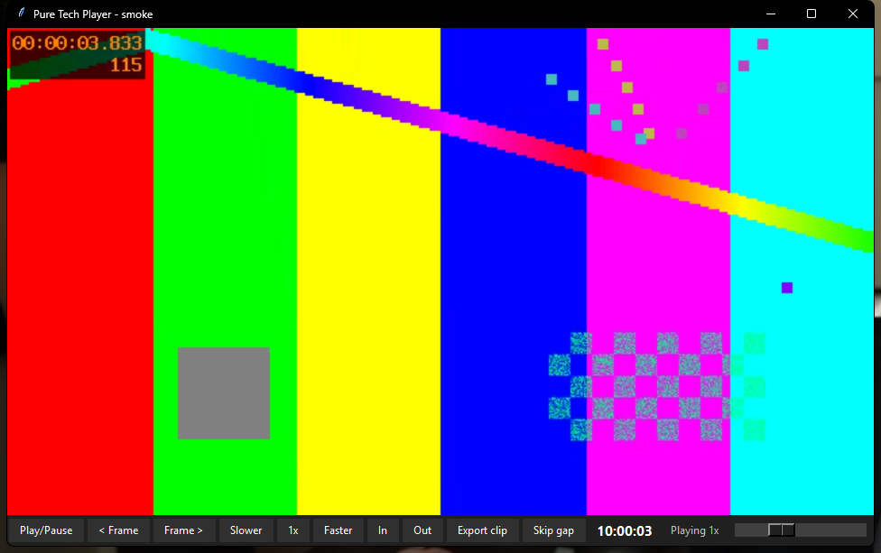

# Pure Tech Player

A playback engine for chunked recordings. Point it at a folder of files named `HH-MM-SS.mp4` inside `YYYY-MM-DD`
day folders (what FrameKeep writes) and it plays them as one
timeline on the wall clock: across file boundaries without a pause, through gaps, at 0.25x to 16x, frame by frame,
and with lossless clip export.



Pure Python on `ctypes`, no packages to install. FFmpeg does the decoding (one process per stream, started ahead
of need), WASAPI plays the sound, Direct3D 11 draws into a Tk frame (GDI where Direct3D is not available).

## Measured against ffplay

Both players open the same generated files (testsrc2 picture with a time code, sine sound, 70 s, a keyframe every
2 s), in the same 1280x720 window, one at a time, silent (volume 0), on one machine (16 logical CPUs, FFmpeg 9.0.1).
`python tools/measure.py` repeats it; the raw numbers are in [docs/perf.json](docs/perf.json).

- **First frame**: from launching the process until the picture is on screen, read off the screen the same way
  for both. Ours is a small Tk app that calls `warm_up()` at start, as an app embedding the player would.
- **Seek**: from the command until the screen shows the target second, while playing. ffplay lands on the keyframe
  before the target; ours shows that keyframe too, then the exact frame (in brackets).
- **CPU**: processor cycles over 60 s at 1x, as % of one core. Windows' own CPU times are charged per 15.6 ms
  clock tick and misread work done in short bursts by a factor of up to three either way, for both players
  (`tools/cycles.py` explains).
- **Private RAM**: memory used by ffplay against memory our player adds to an app already running Python and Tk.

| File | First frame (launch), ffplay / ours | Seek, ffplay / ours (exact frame) | CPU % of one core, ffplay / ours | Private RAM MB, ffplay / ours added | Dropped frames, ffplay / ours |
|---|---|---|---|---|---|
| av1-1080p30 | 348.5 / 327.4 ms | 49.9 ms / 39.1 ms (31.5 ms) | 23 / 16 | 126.5 / 111.8 | 0 / 0 |
| hevc-1080p30 | 352.7 / 353.3 ms | 59 ms (9 of 10 landed) / 53.7 ms (44.7 ms) | 28.6 / 24.1 | 189.3 / 132.9 | 0 / 0 |
| vvc-1080p30 | 482.2 / 312.5 ms | 182 ms / 230.2 ms (250.8 ms) | 107.9 / 52 | 712.7 / 731.6 | 1 / 0 |
| h264-1080p30 | 383.1 / 340.5 ms | 64.3 ms / 52.4 ms (38.6 ms) | 21.9 / 16.9 | 165.5 / 123.5 | 0 / 0 |
| av1-720p15 | 345.2 / 317.9 ms | 40.9 ms / 28.9 ms (21.2 ms) | 7.2 / 5.9 | 69.4 / 65.3 | 0 / 0 |
| hevc-720p15 | 346.9 / 316.2 ms | 53.3 ms / 36.4 ms (28 ms) | 8.2 / 8.3 | 96.7 / 76.4 | 0 / 0 |
| vvc-720p15 | 391.6 / 320.2 ms | 94 ms / 112.1 ms (109.4 ms) | 26.3 / 14.6 | 371.4 / 362.2 | 0 / 0 |
| h264-720p15 | 336.4 / 303.3 ms | 58.4 ms / 32.8 ms (24.6 ms) | 6.7 / 6 | 89.8 / 73.7 | 0 / 0 |

**Where it is better**

- Lower CPU on 7 of 8 files and level on the eighth: H.264 1080p30 16.9% of a core against 21.9%, AV1 16.0%
  against 23.0%, H.266 52.0% against 107.9%.
- Faster seeks on H.264, H.265 and AV1: 29 to 54 ms to the first picture and 21 to 45 ms to the exact frame, against
  41 to 64 ms for ffplay to reach a nearby keyframe.
- Faster first frame on 7 of 8 files (level on the eighth): 303 to 341 ms against 336 to 482 ms.
- Less private memory on 7 of 8 files: 1080p30 H.264 124 against 166 MB, H.265 133 against 189 MB, AV1 112 against
  127 MB.
- No dropped frames on any file.
- 128 KB of Python against a 15.1 MB ffplay.exe, and it does more: one timeline over many files, gaps, speeds to
  16x, frame stepping both ways, grids, lossless clips.

**Where it is worse**

- H.266 seeks to the first picture: 230 ms against 182 ms (720p15: 112 against 94 ms). The player starts on the
  keyframe before the target, and FFmpeg's H.266 decoder only hands that keyframe over once it has decoded the next
  one; ffplay shows whichever keyframe it lands on, often a second past the target. The exact frame follows 20 ms
  later (251 ms).
- H.266 at 1080p30 uses 19 MB more private memory (732 against 713 MB): Python, Tk, the Direct3D device and the two
  idle spare decoders, next to a decoder that alone needs about 660 MB.

**What changed while measuring** (the first working version against this one, 1080p30, same files and method)

| | H.264 | AV1 | H.266 |
|---|---|---|---|
| First frame | 378 to 341 ms | 360 to 327 ms | 377 to 313 ms |
| Seek to first picture | 111 to 52 ms | 83 to 39 ms | 298 to 230 ms (the first version showed the wrong frame) |
| CPU, % of one core | 29.6 to 16.9 | 30.4 to 16.0 | 125.5 to 52.0 |
| Private RAM added | 215 to 124 MB | 180 to 112 MB | 774 to 732 MB |

- Decoders are started ahead of need and wait for their file on stdin, which saves FFmpeg's ~55 ms start-up on
  every seek and chunk change.
- A Direct3D 11 presenter: FFmpeg sends YUV and the graphics card converts and scales it, instead of FFmpeg making
  BGRA for GDI. One device serves every view and starts early (`warm_up()`).
- Four decoding threads per decoder instead of one per core (eight for H.266), AV1 with one frame in flight, and no
  console process per decoder (each used to start a hidden conhost.exe of 7.5 MB).
- Frames cross the pipe in one read instead of three, FFmpeg's log is read by the same thread between frames, and
  the sound thread wakes every 50 ms instead of 10 ms.
- FFmpeg keeps one finished frame waiting for the pipe instead of eight (20 to 24 MB less per decoder at 1080p30).
- Seeks into H.266 and into sparse screen recordings land on the right frame. H.266 seeks start on the right
  keyframe from an index each file gets in the background (exact frame 465 to 251 ms).
- Tried and dropped, because they measured worse or no better: hardware decoding (d3d11va, then copying frames back
  cost more CPU than decoding in software), looking up H.266 keyframes with ffprobe at each seek (817 ms against
  779 ms without), limiting FFmpeg's stream probing (within 5 ms), and the decoder's low-delay mode (H.266 first
  picture 200 to 373 ms).

## Features

- **One timeline from many files.** A source is a list of chunks with wall-clock starts, read from the names
  (`2025-03-04/14-02-08.mp4`, `14-02-08-1.mkv` for a second file in the same second) or given explicitly. The next
  chunk's decoders start before the current one ends, so crossing files is seamless, sound included.
- **Any codec FFmpeg decodes**: H.264, H.265, AV1, H.266 (VVC). Each chunk gets its own decoder, so a codec change
  between chunks just works.
- **Sound leads, picture follows.** The sound card's own position (IAudioClock) is the master clock and video frames
  are shown when it reaches them. Files without sound play on a steady monotonic clock.
- **Gaps** between recordings are reported (`on_state("gap", {...})`) and skipped, or played through and skippable
  with `skip_gap()`.
- **Speed 0.25x to 16x.** Sound up to 2x with pitch kept (atempo), muted above. From 4x the decoder thins frames to
  at most 30 shown per second; from 8x it decodes keyframes only.
- **Frame-accurate seeking**: the keyframe before the target shows at once (faster than ffplay's seek, except on
  H.266), then the exact frame. Step one frame forward or back while paused, also across file boundaries.
- **Grid**: several sources on one shared clock (camera wall), sound from the one you choose.
- **Lossless clips**: stream copy across chunks through FFmpeg's concat demuxer. `plan_clip()` first reports the
  real keyframe-snapped start and end ("Clip will run 14:02:08 to 14:02:41"). Never overwrites a file.
- **Variable frame rate safe**: every frame's real timestamp comes from FFmpeg, so recordings that drop repeated
  frames stay in sync.

## Requirements

- Windows 10 or 11 (Direct3D 11 graphics for the GPU presenter; GDI is used otherwise)
- Python 3.10 or newer (Tk is included with the python.org installer)
- FFmpeg 7.1 or newer with `ffmpeg` and `ffprobe` (H.266 needs FFmpeg's native VVC decoder). Pass its path with
  `ffmpeg=` or put it on PATH.

## Install

```
pip install git+https://github.com/puretechteam/puretech-player
```

Or copy the `puretech_player` folder into your project; it has no dependencies.

## Quick start

```python
import tkinter as tk
from puretech_player import Player, VideoView, warm_up

warm_up()                       # start Direct3D now, so the first video does not wait for the graphics driver
root = tk.Tk()
view = VideoView(root, width=1280, height=720)
view.pack(fill="both", expand=True)

player = Player(r"D:\Recordings\Camera 1", view=view)   # a folder, a file, or a list of files
player.play()

root.mainloop()
player.close()
```

Try it on your own folder with the demo:

```
python demo.py "D:\Recordings\Camera 1" --play
```

Demo keys: Space play/pause, Left/Right 5 s back/forward, comma/period one frame back/forward, `[` and `]` slower
and faster, I and O set a clip's in and out, E exports it next to the first chunk, G skips a gap.

## API

### Player

`Player(sources, ffmpeg=None, view=None, presenter=None, audio=True, skip_gaps=True, clock=None, threads=None,
volume=1.0)`

| Call | What it does |
|---|---|
| `play()`, `pause()`, `toggle()` | Start and stop. |
| `seek(wall_time)` | Go to a wall-clock time (epoch seconds). |
| `set_speed(x)` | 0.25 to 16. |
| `step(+1)`, `step(-1)` | One frame forward or back (pauses first). |
| `skip_gap()` | Jump over the gap playback is waiting in. |
| `set_volume(0..1)` | This player's volume (its own audio session). |
| `position` | Wall-clock time on screen now. |
| `state` | `loading`, `playing`, `paused`, `gap`, `ended`. |
| `on_time = fn(wall)` | Called after each shown frame and each seek. |
| `on_state = fn(state, info)` | Called on each state change; `gap` carries `start`, `end` and `skipped`. |
| `stats` | Frames shown and dropped, decoders started, seeks, gaps. |
| `close()` | Stop and free everything. |

Every call returns at once (it queues a command for the player's thread). Callbacks run on the player's thread:
hand them to Tk with a queue or `after()`.

### Source

`Source.from_folder(path)`, `Source.from_files(paths)`, or `Source([Chunk(path, start, duration)])` for explicit
starts. `source.locate(wall)` tells where a time falls (chunk and offset, or a gap), `source.gaps()` lists the holes.
A chunk's length is probed with ffprobe the first time it is needed, so opening a day of one-minute chunks is quick.

### Grid

```python
grid = Grid([cam1_folder, cam2_folder], views=[view1, view2], audio=0)
grid.play(); grid.seek(t); grid.set_speed(4); grid.step(1); grid.set_audio(1)
```

All tiles follow one clock: the sound tile's while it makes sound, a monotonic one otherwise. When every tile is in a
gap, the grid jumps to the next footage.

### Clips

```python
from puretech_player import plan_clip, export_clip
plan = plan_clip(source, t_in, t_out)       # probes keyframes, nothing written yet
print(plan.describe())                      # "Clip will run 14:02:08 to 14:02:41"
files = export_clip(plan, r"D:\Clips\door.mp4")
```

The start snaps back to the keyframe at or before `t_in` (a stream copy can only start there); the end is the frame
boundary at `t_out` (`keyframe_end=True` snaps it forward to a keyframe instead). Gaps inside the clip are closed up
and listed in `plan.gaps`. If the codec changes inside the clip, one file per codec is written (`door-1.mp4`,
`door-2.mp4`).

### Drawing elsewhere

The player draws through a `Presenter` (`present(frame)`, `redraw()`, `clear()`, `size()`, and `pixel_format`
telling the decoder what to send). `VideoView(parent, backend="d3d11")` uses `D3D11Presenter` and falls back to
`GdiPresenter` by itself; pass `backend="gdi"` to force GDI. `make_presenter(hwnd)` does the same for any window
handle, and `NullPresenter` draws nothing (headless use and tests).

`warm_up()` starts the process's Direct3D device in the background. The first one costs about 200 ms while the
graphics driver loads, so call it when your app starts. Every view shares that one device. A `VideoView` keeps its
presenter for every Player shown in it; closing a Player clears the picture, and destroying the view stops the
Players in it first.

## How it works

- **Video**: one FFmpeg per chunk decodes and writes raw frames to a pipe; `showinfo` reports each frame's timestamp
  and size on stderr. With Direct3D 11 the frames are planar YUV at the source size (shrunk only when the source is
  more than 1.5 times the window) and the graphics card converts and scales them, like ffplay. With GDI they are BGRA
  fitted to the window and drawn with `SetDIBitsToDevice`. The render thread shows each frame when the clock reaches
  it, and drops a frame only when the one after it is already due.
- **Spares**: starting FFmpeg costs about 55 ms on Windows before it reads a byte. One idle video decoder and one
  idle audio decoder are always started and waiting for an ffconcat script on stdin (file and in point), so a seek or
  the next chunk only pays for opening and decoding.
- **Sound**: a second FFmpeg per chunk writes 48 kHz float stereo into a WASAPI shared-mode stream. Chunks are strung
  into one continuous stream; each piece marks the device frame where it starts, which maps the sound card's position
  back to wall time.
- **Seeking**: the in point puts earlier frames at negative times; `select` drops them except the keyframe, which
  is shown first as a preview. MP4 seeks go by decode time, and an H.266 keyframe is decoded about a second before
  it shows, so a plain seek often starts on the keyframe after the target. H.266 seeks therefore start just before
  the right keyframe, taken from the file's keyframe index (read once per file in the background). If the first
  frame FFmpeg returns is still later than the target (an index not read yet, or a sparse screen recording with no
  frame there), the player decodes again from 3 s earlier and shows the last frame at or before the target.
- **Processes**: decoders run detached (no console) inside a job object, so none outlives the app even if it
  crashes. They use four decoding threads (eight for H.266, whose seeks decode a whole keyframe interval), and AV1
  keeps one frame in flight (decoder memory 116 to 92 MB at 1080p30, seeks 14 ms slower, still ahead of ffplay).
  Playback paces the pipe, so FFmpeg's queues stay full: its output queue is cut to one frame (`-thread_queue_size
  1`).

## Speed rules

| Speed | Sound | Frames |
|---|---|---|
| 0.25x to 2x | on, pitch kept | all |
| above 2x to under 4x | muted | all |
| 4x to under 8x | muted | at most 30 shown per second, the rest skipped before scaling |
| 8x to 16x | muted | keyframes only (`-skip_frame nokey`) |

## Tests

```
pip install pytest
python -m pytest
```

Unit tests cover timeline mapping, gaps, the prefetch plan, the speed rules, clip commands and snapping, and the
clock math against a fake sound device. Integration tests generate clips with FFmpeg (testsrc2 and a sine tone) in
temporary folders and play them headless.

## Measuring against ffplay

```
pip install psutil
python tools/measure.py
```

Makes 70 s test files (1080p30 and 720p15 in AV1, H.265, H.266 and H.264) in `work/measure-tc`, then measures
both players the same way. Takes about 30 minutes and opens windows on screen while it runs. Results go to
`docs/perf.json`.

## License

MIT, see [LICENSE](LICENSE). FFmpeg is not included; it has its own licenses.
